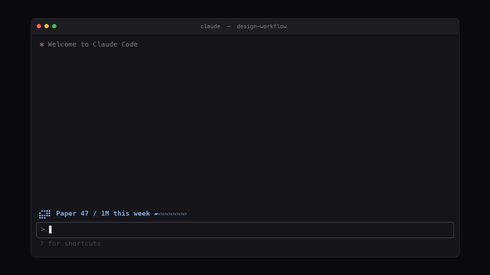

# paper-meter

A Claude Code mod that counts your [Paper](https://paper.design) MCP tool calls
and shows the weekly total in a band above the prompt, so you can see the
quota coming before Paper cuts you off.



<sub>[Watch the full-quality video](assets/demo.mp4) · the band in your terminal:</sub>

```
⣮⡽⠇ Paper 42 / 100 this week ▰▰▰▱▱▱▱▱
```

Paper's free plan allows 100 MCP calls a week and Pro allows 1,000,000.
Paper doesn't show how many you've used. This mod keeps its own count.

## Install

At the Claude Code prompt:

```
/plugin install paper-meter --marketplace leowalton/paper-meter
```

Answer `y` to add the marketplace, then pick a scope (user is best, so every
project is counted).

From a shell:

```sh
claude plugin install paper-meter --marketplace leowalton/paper-meter
```

## What you get

- **A band above the prompt** with Paper's mark, the 7-day count and a usage
  meter. It turns to the warning colour past 80%, and stays hidden until you've
  made a Paper call that week.
- **Toasts** at 80% and 100% of your quota.
- **`/paper-usage`**: today's count, the 7-day total, the top Paper tools, and
  when the oldest day drops out of the window.

## Settings

Set these in the plugin config menu (`/plugin`), or in `settings.json` under
`pluginConfigs["paper-meter"].options`:

| Option | Default | |
|---|---|---|
| `plan` | `free` | `free` (100/week) or `pro` (1M/week) |
| `show` | `true` | Show the band |
| `color` | `#7BA7E9` | Hex colour for the mark and count |

## Limits

- **It's an estimate.** It counts only the Paper calls Claude Code makes, from
  install onwards. Calls from other apps or agents using Paper's MCP aren't
  seen.
- **Rolling 7 days.** Paper's own reset date isn't published, so the window is
  the last 7 days.
- Each call is counted once, even if the mod is loaded twice, because it
  dedupes by `tool_use_id`.
- The band draws in the terminal and the desktop app. `/paper-usage` works
  everywhere.

Tested with Claude Code 2.1.319.

## Unofficial

Not affiliated with or endorsed by Paper. The mark is Paper's, redrawn in
braille dots to label what's being counted.

## License

MIT
